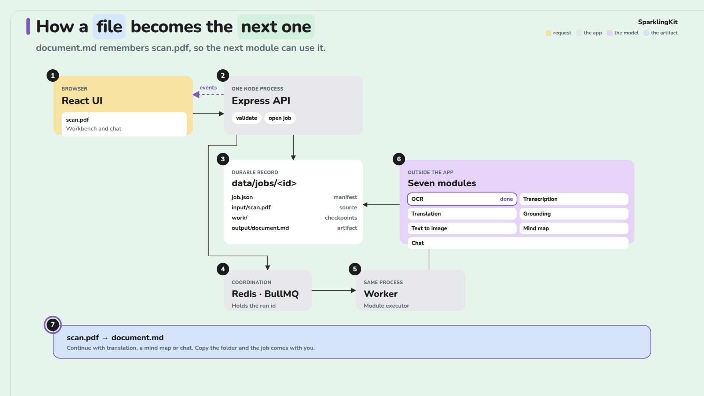

# Architecture diagram

A 30-second Remotion diagram of how one file moves through SparklingKit. The board stays up the whole time: pastel cards, a number on each step, and a ring that walks from the upload to the artifact. The sentence under the title changes with the ring.

[architecture.mp4](architecture.mp4)



It is a documentation render. The app does not load it, and Compose does not start it.

```bash
cd diagrams/architecture
npm install
npm test
npm run dev      # studio, to scrub the timeline
npm run render   # out/architecture.mp4
npm run still    # out/poster.png, the closing frame
```

`architecture.mp4` and `poster.png` are a render of this composition. Re-render them after changing the story.

The first render downloads a headless Chrome. The story and the coordinates live in `src/script.ts` and `src/geometry.ts`; `npm test` checks that the sentences cover the timeline and that the arrows stay off the cards.
